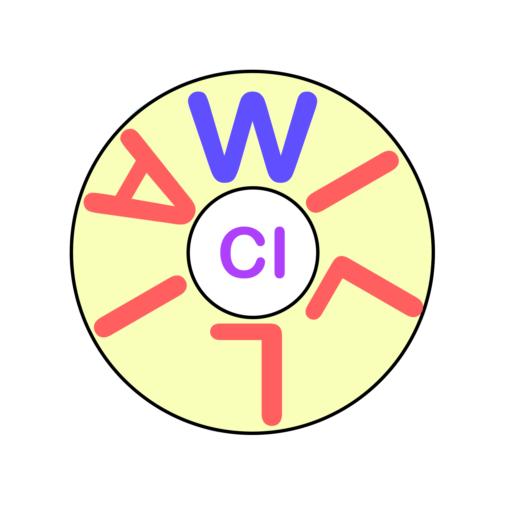

<br />
<div align="center">
  <a href="https://github.com/ALRAKIK/William_CI">
    
  </a>

  <h3 align="center">William_CI Project</h3>

  <p align="center">
    Calculate the quantum chemistry integrals required for the Hartree-Fock method, MP2, and CCSD(T). 
    <br />
    <a href="https://github.com/ALRAKIK/William_CI"><strong>Explore the Project »</strong></a>
    <br />
    <br />
  </p>
</div>

<!-- TABLE OF CONTENTS -->
<details>
  <summary>Table of Contents</summary>
  <ol>
    <li>
      <a href="#prerequisite">Getting Started</a>
      <ul>
        <li><a href="#prerequisite">Prerequisites</a></li>
        <li><a href="#build">Build</a></li>
      </ul>
    </li>
    <li><a href="#usage">Usage</a></li>
    <li><a href="#example">Example</a></li>
    <li><a href="#contact">Contact</a></li>
    <li><a href="#license">License</a></li>
    <li><a href="#acknowledgments">Acknowledgments</a></li>
  </ol>
</details>

# William CI
A program to calculate the integrals needed in a quantum chemistry code and calculate the energy of the ground state using the Hartree-Fock, MP2, or CCSD(T) (if required).

# Prerequisite

* 1 - Fortran compiler (gfortran 9.4 recommended):

```
sudo apt install gfortran
```
* 2 - Fortran library (llapack, openmp,gsl):
  
```
sudo apt install liblapack-dev libopenblas-dev libomp-dev
```

* 3 - trexio:

Have a look at https://github.com/TREX-CoE/trexio

# Build

* build the program
  
```sh
make
```
* clean the bin files
```sh
make clean
```

# Usage 

* 1 - Put the input file (unitcell.mol) and the basis file (Basis) in the same directory.
* 2 - run the program using:
  ```
  CI_pop
  ```
* 3 - This will give the user an output file in the same directory called "results_****.out"


# unitcell.mol file 

* The first line contains the type of calculation, the number of unit cells, the distance between the unit cells, and the length of the torus.

  | type of calculation                | `char` (  'OBC'  ,  'Ring' ,  'Tori1D'  ,  'Tori2D'  ,  'Tori3D'  )

    * * `OBC` Open boundry condation == molecular calculation 

    * * `Ring` molecular with ring geometry (If user inserts only atoms on x axis)
 
    * * `Tori1D`     using Clifford Gaussian in one dimension

    * * `Tori2D`     using Clifford Gaussian in two dimensions
 
    * * `Tori3D`     using Clifford Gaussian in  three dimensions
 
  | number of unitcells                | `int`

  | distance between the unitcells     | `real`

  | length of the Torus in x direction | `real` (length of the torus on y and z is the same as the length on x)


* all the lines between the first line and the line contain the $$ sign can contain a keyword:

  `Integrals`  only calculate the integrals without doing HF 

  `Read`       read the integrals from a file then do a HF calculation

  `Trexio`     write the integrals as a trexio file (to be used with other programs like (quantum package) )

* user can write the geometry for the unit cell using $$ sign form a line then go to the next line and add the geometry and end with $$ sign again, for example:three dimensions

  ```
  $$
  H      0.0000000000	     0.000000000	     0.00000000
  $$
  ```
  
* **Example:**

  Calculation using Clifford Gaussian in one direction with two unit cells and a distance between them of 1.8000 and the length of the Torus 3.60000

  ```
  Tori  2    1.8000000    3.6000000000
  $$
  H      0.0000000000	     0.000000000	     0.00000000
  $$
  ```

# Basis file

  Reading the same basis file as Dalton, the user should rename the basis file to "Basis"
  


# Contact

Amer Alrakik        - amer.alrakik@irsamc.ups-tlse.fr

Arjan Berger        - arjan.berger@irsamc.ups-tlse.fr

Stefano Evangelisti - stefano.lcpq@gmail.com

Project Link: [https://github.com/ALRAKIK/William](https://github.com/ALRAKIK/CI_pop)

# License

Distributed under the MIT License. See `LICENSE.txt` for more information.

# Acknowledgments

quadpack team : https://github.com/jacobwilliams/quadpack
Trexio   team : https://github.com/TREX-CoE/trexio
